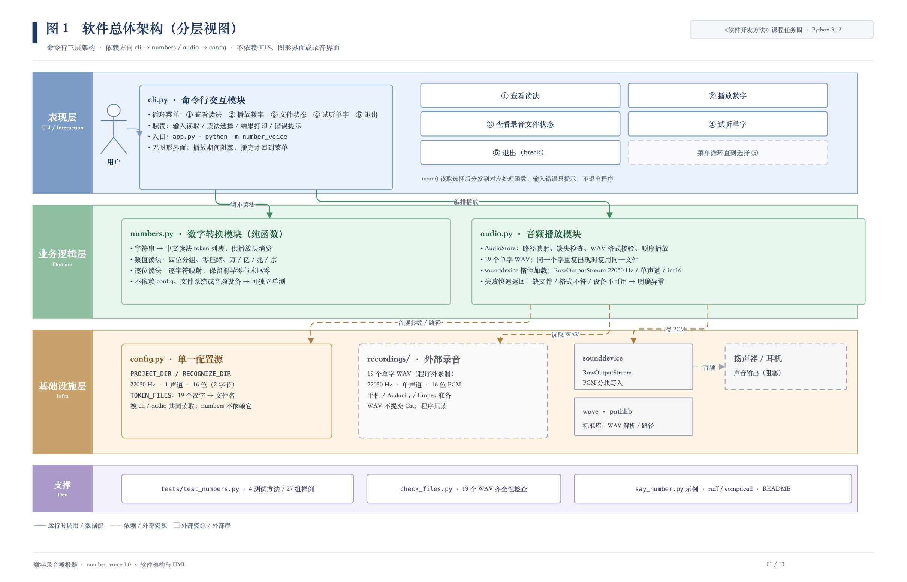
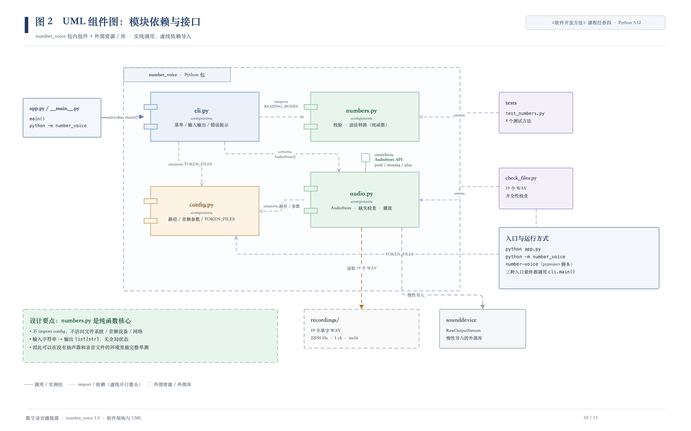
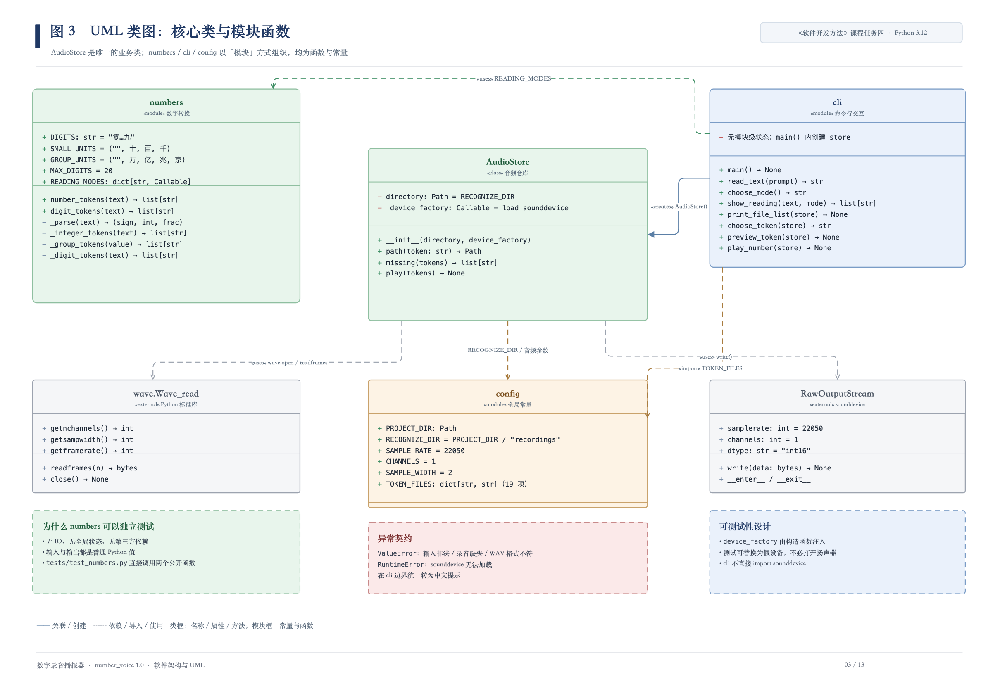
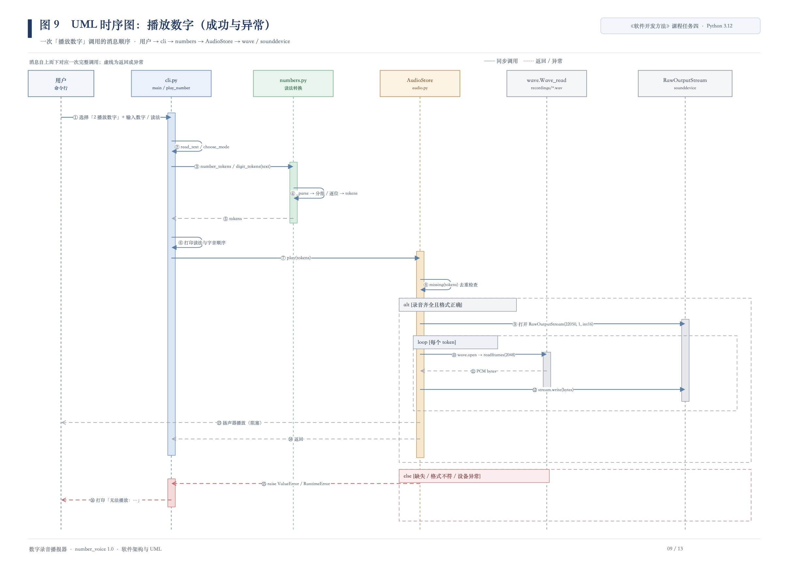
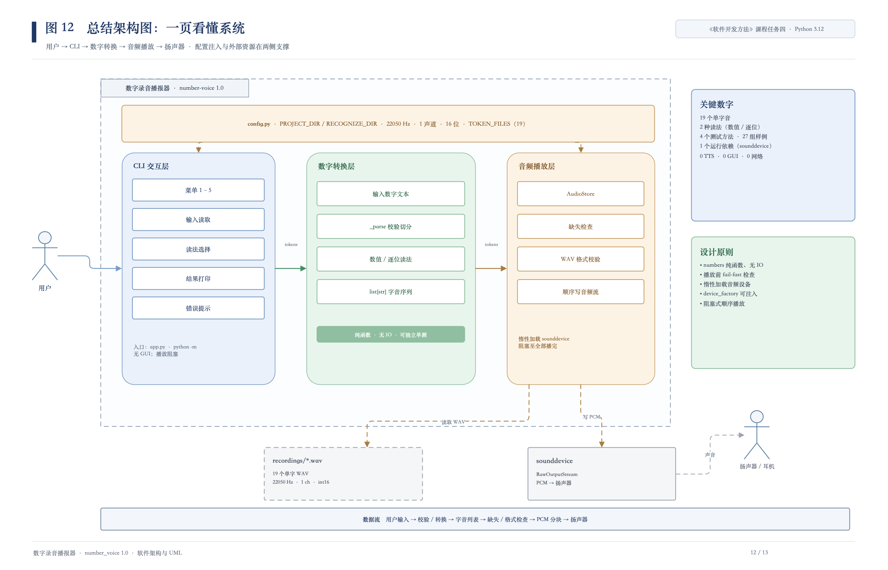

# 数字录音播报器

《软件开发方法》课程任务四项目：输入一串数字，程序按中文读法拆成字音，再播放使用者自己录制的单字 WAV。项目不使用 TTS、语音合成包或现成的数字转语音组件。

程序采用命令行菜单，不依赖图形界面。录音由外部工具完成，程序负责数字转换、录音文件检查、试听和顺序播放。

## 功能

- 命令行菜单：查看读法、播放数字、查看录音文件状态、试听单字、退出。
- 支持“数值读法”和“逐位读法”两种模式。
- 数值读法按中文四位分组规则读出，支持负数和小数。
  - `2382` → `二千三百八十二`
  - `10001` → `一万零一`
  - `-23` → `负二十三`
  - `12.34` → `十二点三四`
  - `12.50` → `十二点五零`
  - `0023` → `零零二三`（逐位读法）
- 播放前检查 `recordings/` 中缺少哪些字音，并给出提示。
- 播放时按字音清单逐段读取 WAV，同一个字出现多次时重复播放同一个文件。

## 开发环境

- Python 3.12.14（已验证）
- `sounddevice` 0.4.6 及以上、1.0 以下
- 可用于准备 WAV 的录音工具，例如手机、系统录音工具或 Audacity
- 可用的扬声器

项目不依赖 Tkinter 或其他图形界面库。

## 安装

macOS / Linux：

```bash
python3 -m venv .venv
source .venv/bin/activate
python -m pip install -r requirements.txt
```

Windows PowerShell：

```powershell
py -3.12 -m venv .venv
.\.venv\Scripts\Activate.ps1
python -m pip install -r requirements.txt
```

如果已经使用 Python 3.12.14 的 conda 环境，也可以直接激活该环境后安装依赖。

依赖只有：

```text
sounddevice>=0.4.6,<1.0
```

## 运行

```bash
python app.py
```

也可以使用包入口：

```bash
python -m number_voice
```

启动后显示：

```text
数字录音播报器

1. 查看读法
2. 播放数字
3. 查看录音文件状态
4. 试听单字
5. 退出
请选择 [1-5]：
```

## 发布

最新版本：[v1.1.2](https://github.com/mingshiyouzuo/Task4/releases/tag/v1.1.2)

- macOS arm64 可直接下载 Release 附件 `number-voice-v1.1.2-macos-arm64`，执行 `chmod +x` 后与 `recordings/` 放在同一目录运行。
- Windows / Linux 请从源码运行，或自行使用 PyInstaller 打包。
- v1.1.2 修复 PyInstaller 打包后找不到 `recordings/` 与 `sounddevice/PortAudio` 的问题。
- Release 不包含个人录音 WAV。

## 录音文件

程序不提供录音界面，需要提前准备 19 个单字 WAV：

```text
零、一、二、三、四、五、六、七、八、九、十、百、千、万、亿、兆、京、负、点
```

统一格式：

```text
22050 Hz、单声道、16 位 PCM WAV
```

文件名对照：

| 汉字 | 文件名 | 汉字 | 文件名 |
| --- | --- | --- | --- |
| 零 | `ling.wav` | 一 | `yi.wav` |
| 二 | `er.wav` | 三 | `san.wav` |
| 四 | `si.wav` | 五 | `wu.wav` |
| 六 | `liu.wav` | 七 | `qi.wav` |
| 八 | `ba.wav` | 九 | `jiu.wav` |
| 十 | `shi.wav` | 百 | `bai.wav` |
| 千 | `qian.wav` | 万 | `wan.wav` |
| 亿 | `yi_large.wav` | 兆 | `zhao.wav` |
| 京 | `jing.wav` | 负 | `fu.wav` |
| 点 | `dian.wav` |  |  |

如果原文件是手机常见的 44.1 kHz 立体声，可以用 ffmpeg 转换：

```bash
ffmpeg -i input.m4a -ar 22050 -ac 1 -sample_fmt s16 recordings/er.wav
```

没有 ffmpeg 时，可以用 Audacity 导出为“WAV (Microsoft) signed 16-bit PCM”，采样率选 22050，声道选单声道。

准备文件后运行程序，通过菜单 `3` 查看 19 个字音的状态。

## 输入规则

- 只接受非空数字文本，可带一个前导负号和一个小数点。
- 小数部分逐位读，并保留末尾零：`12.50` → `十二点五零`。
- `.5` 按 `零点五` 处理；`12.`、`.`、`1.2.3` 不合法。
- 数值读法最多处理 20 位有效整数数字，最高单位为“京”；更长的整数部分自动逐位读。
- 小数部分始终逐位读。
- 不接受空格、正号、全角数字或千分位逗号。

## 软件架构

程序采用三层结构：

- **表现层** `cli.py`：菜单循环、输入读取、读法选择、结果打印与错误提示，不含业务规则；
- **业务逻辑层**：`numbers.py` 是纯函数模块（数字文本 → 字音列表，无 IO）；`audio.py` 的 `AudioStore` 负责路径映射、缺失检查、WAV 格式校验与顺序播放；
- **基础设施层** `config.py`：唯一的配置来源，集中保存录音目录、采样率/声道/位深和 19 个字音文件名。

依赖方向为 `cli → numbers / audio → config`，不使用 TTS、图形界面或网络。

下面选 5 张图展示，图号沿用完整图集。

**图 1　软件总体架构（分层视图）**



**图 2　UML 组件图：模块依赖与接口**



**图 3　UML 类图：核心类与模块函数**



**图 9　UML 时序图：播放数字（成功与异常）**



**图 12　总结架构图：一页看懂系统**



完整 13 张图（含用例图、模块详解、活动图、状态图和总结流程图）保存在可编辑源文件 [`docs/数字录音播报器-软件架构与UML.drawio`](docs/数字录音播报器-软件架构与UML.drawio) 中。

## 项目结构

```text
Task4/
├── app.py                     # 启动入口
├── number_voice/
│   ├── __init__.py            # 包信息
│   ├── __main__.py            # python -m number_voice
│   ├── config.py              # 路径、音频参数、字音文件名
│   ├── numbers.py             # 数字 → 中文读法
│   ├── audio.py               # WAV 检查与播放
│   └── cli.py                 # 命令行菜单
├── tests/
│   └── test_numbers.py        # 数字读法测试
├── docs/
│   ├── 数字录音播报器-软件架构与UML.drawio
│   └── images/                # 5 张精选架构图（README 引用）
├── recordings/                # 外部录制的 WAV
├── requirements.txt
├── pyproject.toml
└── README.md
```

## 设计说明

- `numbers.py` 只负责字符串到字音列表的转换，不访问文件或音频设备，便于单独测试。
- `audio.py` 的 `AudioStore` 负责路径、缺失检查、WAV 格式检查和顺序播放，不负责录音。
- `cli.py` 负责菜单、输入和输出；播放是阻塞的，播放结束才回到菜单。
- `config.py` 集中保存目录、采样率、位深和 19 个字音的文件名。
- 依赖方向为 `cli → numbers / audio → config`。

## 测试

```bash
python -m unittest discover -s tests -v
```

`tests/` 只包含数字读法测试，共 4 个测试方法、27 组读法样例和 26 组非法输入组合（13 种非法文本 × 2 个转换函数），覆盖原题示例、负数、小数、补零、超长降级和非法输入。

音频播放涉及真实扬声器和外部 WAV，不包含在自动测试中。请使用菜单 `3`（文件状态）、菜单 `4`（试听单字）和菜单 `2`（播放数字）人工验证。

其他检查：

```bash
python -m compileall -q app.py number_voice tests
```

## 已知限制

- 程序只检查 WAV 是否存在和格式是否匹配，不判断录音内容是否清晰。
- 播放不自动裁剪静音，字与字之间可能有停顿。
- 不提供录音界面，录音文件需要由外部工具准备。
- 命令行播放期间不能接受下一个菜单命令。
